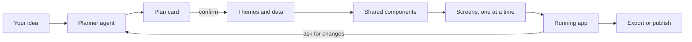

# AppForge

**Describe an app and get a working one.** AppForge is an AI agent that turns an idea into a real Expo (React Native) mobile app. It plans the screens with you, builds them one at a time, and lets you preview, edit, and publish the result.

## Features

- **Plan first.** The agent proposes a screen plan in chat and builds only after you confirm it.
- **Live generation.** Screens are built one at a time in background jobs, with progress streamed to the workspace.
- **Live preview and code.** Tap through the running app in the browser and browse its files.
- **Edit by chat.** Ask for a change and only the affected screens or components are regenerated.
- **Inline editing.** Click any element to change it, and see the result instantly with no reload.
- **Instant themes.** Every app comes with 5 themes, and switching rebuilds nothing.
- **Reusable components.** Screens share a component library, so one change updates the whole app.
- **AI images.** Generate and transform images with ImageKit.
- **Real backend.** Connect CloudHike to give an app its own database, sign-in, and storage.
- **Test on a phone.** Scan a QR code to run the app in Expo Go, with live updates.
- **Own your code.** Download a complete Expo project as a ZIP, or push it to GitHub.
- **Publish.** Export `.aab`, `.apk`, and `.ipa` files, or publish a website, through your own Expo account.
- **Share.** Share a project with someone by email, or make it public on the home page.
- **Free and Pro plans.** Plan limits and usage credits, with subscriptions through Stripe.

## How it works



Six specialized agents share the work. Generated code runs in a sandboxed frame, and each step of a build is a background job, so a build isn't limited by one request's timeout.

- **[docs/project-prompts.md](docs/project-prompts.md)** has every prompt used to build AppForge, chapter by chapter, and every prompt its agents use at runtime.
- **[docs/app-builder-roadmap.md](docs/app-builder-roadmap.md)** explains how builds, previews, backends, publishing, and billing work.

## Tech stack

| Area | Tools |
|---|---|
| App | Next.js 16, React 19, TypeScript |
| UI | Tailwind CSS 4, shadcn/ui, Lucide icons |
| AI | OpenAI Agents SDK with Claude, through Anthropic's OpenAI-compatible API |
| Database | PostgreSQL, Drizzle ORM |
| Auth, storage, and jobs | CloudHike |
| Generated apps | Expo, React Native, `react-native-web` for the preview, Expo Snack for phones |
| Images | ImageKit |
| Publishing | Expo Application Services (EAS) |
| Payments | Stripe |

## Getting started

### Prerequisites

- Node.js 20.9 or newer
- A PostgreSQL database and a CloudHike project
- An Anthropic API key

### Setup

```bash
git clone https://github.com/rrs301/appForge-Ai-agent-mobile-app-builder.git
cd appForge-Ai-agent-mobile-app-builder
npm install
cp .env.example .env     # then fill in the values, see below
npm run db:push          # create the database tables
npm run dev
```

Open [http://localhost:3000](http://localhost:3000).

`npm run dev` and `npm run build` first bundle the preview runtime automatically.

### Environment variables

[.env.example](.env.example) lists every variable, with notes on where to find each value.

**Needed to build apps:**

| Variables | Used for |
|---|---|
| `NEXT_PUBLIC_APP_URL` | This site's address |
| `DATABASE_URL`, `DIRECT_URL` | PostgreSQL |
| `AUTH_URL`, `AUTH_PUBLISHABLE_KEY`, `AUTH_SECRET_KEY` | Sign-in, through CloudHike Auth |
| `AI_BASE_URL`, `AI_API_KEY` | The AI agents |
| `JOBS_API_URL`, `JOBS_API_KEY` | Background screen generation, through CloudHike Jobs |
| `S3_ENDPOINT`, `S3_REGION`, `S3_BUCKET`, `S3_ACCESS_KEY_ID`, `S3_SECRET_ACCESS_KEY` | Files attached to prompts, through CloudHike Storage |

**Optional, each turns on a feature:**

| Variables | Turns on |
|---|---|
| `CLOUDHIKE_CLIENT_ID`, `CLOUDHIKE_CLIENT_SECRET` | Connect Backend for generated apps |
| `CLOUDHIKE_ENCRYPTION_KEY` | Encrypts stored tokens. Needed for Connect Backend, Push to GitHub, and Publish |
| `GITHUB_CLIENT_ID`, `GITHUB_CLIENT_SECRET` | Push to GitHub |
| `IMAGEKIT_ENABLED`, `IMAGEKIT_PRIVATE_KEY`, `IMAGEKIT_URL_ENDPOINT` | AI images. Without them, apps use placeholder images |
| `STRIPE_SECRET_KEY`, `STRIPE_WEBHOOK_SECRET`, `STRIPE_PRO_PRICE_ID` | Pro subscriptions |
| `AI_MODEL`, `AI_BUILDER_MODEL` | Different models. Both default to `claude-sonnet-5-5` |
| `DEFAULT_SCREEN_COUNT` | Most screens in a plan unless someone asks for more. Defaults to 3 |

Publishing doesn't need a server-side Expo key, because each person connects their own Expo access token.

### Local development with background jobs

CloudHike Jobs can't call `localhost`, so screen generation needs a tunnel to your dev server:

```bash
ngrok http 3000
```

Then set `JOBS_PUBLIC_URL` in `.env` to the tunnel's address. Planning works without this, but builds won't run.

### Scripts

| Command | What it does |
|---|---|
| `npm run dev` | Starts the dev server |
| `npm run build` | Builds for production |
| `npm start` | Runs the production build |
| `npm run db:generate` | Creates a migration from `db/schema.ts` |
| `npm run db:push` | Applies the schema to the database |
| `npm run db:studio` | Opens Drizzle Studio |

## Project structure

```text
app/                 Pages and API routes
  api/projects/      Projects, the agent stream, files, and publishing
  api/jobs/          The background build worker
  workspace/         The chat, canvas, and preview screen
components/
  home/              Landing page and project cards
  workspace/         Chat, canvas, preview, and dialogs
  billing/           Pricing, usage, and upgrade prompts
  ui/                Shared UI components
lib/
  agent/             AI agents, prompts, and build steps
  generated-app/     Turns an agent's output into an Expo project
  cloudhike/         Backends for generated apps
  publish/           Native builds and web publishing, through Expo
  github/            Push to GitHub
  billing/           Credits and Stripe
preview-runtime/     Runs generated apps in the browser
db/                  Database schema
drizzle/             Migrations
docs/                Project documentation
```

## Plans

| | Free | Pro |
|---|---|---|
| Projects | 2 | Unlimited |
| Screens per project | 5 | 10 |
| Credits | 100, one time, never expire | 1,000 a month, unused credits expire at renewal |
| Android and iOS builds | No | Yes |
| Web publishing, ZIP, and GitHub | Yes | Yes |

A new screen costs 10 credits, a round of changes costs 5, and an AI image in edit mode costs 1. Chatting, planning, and switching themes are free. All limits are set in [lib/plans.ts](lib/plans.ts).

## Build it chapter by chapter

Each chapter has its own branch holding the finished code for that step. The prompts and explanations are in [docs/project-prompts.md](docs/project-prompts.md).

| # | Chapter | Prompts | Code |
|---|---|---|---|
| 1 | Home Screen Layout | [Prompts](docs/project-prompts.md#chapter-1-home-screen-layout) | [Branch](https://github.com/rrs301/appForge-Ai-agent-mobile-app-builder/tree/1.-Home-Screen-Layout) |
| 2 | Auth and Database Setup | [Prompts](docs/project-prompts.md#chapter-2-auth-and-database-setup) | [Branch](https://github.com/rrs301/appForge-Ai-agent-mobile-app-builder/tree/2.-Auth-%26-DB-Setup) |
| 3 | Create New Project | [Prompts](docs/project-prompts.md#chapter-3-create-new-project) | [Branch](https://github.com/rrs301/appForge-Ai-agent-mobile-app-builder/tree/3.-Create-New-Project) |
| 4 | Workspace Layout | [Prompts](docs/project-prompts.md#chapter-4-workspace-layout) | [Branch](https://github.com/rrs301/appForge-Ai-agent-mobile-app-builder/tree/4.Workspace-layout) |
| 5 | AI Agent Configuration | [Prompts](docs/project-prompts.md#chapter-5-ai-agent-configuration) | [Branch](https://github.com/rrs301/appForge-Ai-agent-mobile-app-builder/tree/5.AI-agent-configuration) |
| 6 | Build App Screens | [Prompts](docs/project-prompts.md#chapter-6-build-app-screens) | [Branch](https://github.com/rrs301/appForge-Ai-agent-mobile-app-builder/tree/6.-Build-App-Screens) |
| 7 | App Backend with CloudHike | [Prompts](docs/project-prompts.md#chapter-7-app-backend-with-cloudhike) | [Branch](https://github.com/rrs301/appForge-Ai-agent-mobile-app-builder/tree/7.-App-Backed-Integration-with-Cloudhike) |
| 8 | Inline Screen Editing | [Prompts](docs/project-prompts.md#chapter-8-inline-screen-editing) | [Branch](https://github.com/rrs301/appForge-Ai-agent-mobile-app-builder/tree/8.Inline-Screen-Editing) |
| 9 | Expo Preview with QR Code | [Prompts](docs/project-prompts.md#chapter-9-expo-preview-with-qr-code) | [Branch](https://github.com/rrs301/appForge-Ai-agent-mobile-app-builder/tree/9.Expo-Preview-with-QR-Code) |
| 10 | ImageKit AI Transformation | [Prompts](docs/project-prompts.md#chapter-10-imagekit-ai-transformation) | [Branch](https://github.com/rrs301/appForge-Ai-agent-mobile-app-builder/tree/10.Imagekit-AI-Transformation) |
| 11 | Export as ZIP and Push to GitHub | [Prompts](docs/project-prompts.md#chapter-11-export-as-zip-and-push-to-github) | [Branch](https://github.com/rrs301/appForge-Ai-agent-mobile-app-builder/tree/11.Export-App-as-Zip-and-Push-to-Github) |
| 12 | Android and iOS Build Files | [Prompts](docs/project-prompts.md#chapter-12-android-and-ios-build-files) | [Branch](https://github.com/rrs301/appForge-Ai-agent-mobile-app-builder/tree/12.-Android-%26-Ios-Build-Files) |
| 13 | Publish as a Website | [Prompts](docs/project-prompts.md#chapter-13-publish-as-a-website) | [Branch](https://github.com/rrs301/appForge-Ai-agent-mobile-app-builder/tree/13.-Export-and-Dpeloy-as-a-Web) |
| 14 | Projects on the Home Page | [Prompts](docs/project-prompts.md#chapter-14-projects-on-the-home-page) | [Branch](https://github.com/rrs301/appForge-Ai-agent-mobile-app-builder/tree/14.Display-All-Project-on-Home-Page) |
| 15 | Free and Pro Plans | [Prompts](docs/project-prompts.md#chapter-15-free-and-pro-plans) | [Branch](https://github.com/rrs301/appForge-Ai-agent-mobile-app-builder/tree/15.Free-and-Pro-Plan-Setup) |
